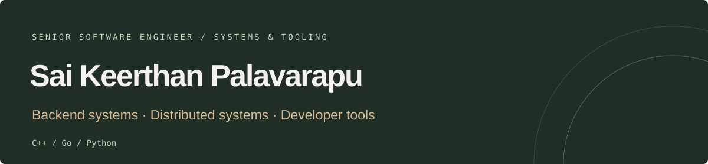
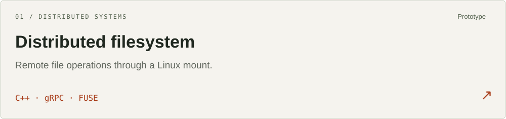
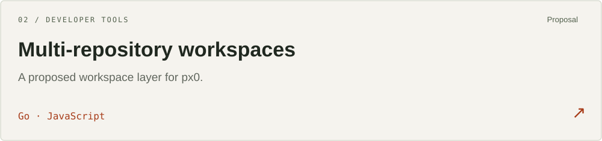
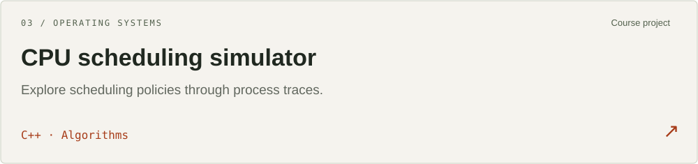

I work on **backend systems and developer tools**. My projects explore the boundaries between local files and remote storage, scheduling policies and process execution, and developers and their workspaces.

[LinkedIn](https://www.linkedin.com/in/saikeerthan/) · [Email](mailto:saikeerthanp.su@gmail.com)

## Selected projects

A single-server prototype for remote reads, writes, metadata, and deletion through a Linux filesystem mount. Explores timestamp-based write rejection; caching, replication, and authentication remain future work.

A proposed workspace layer for px0 using repository-specific servers and a shared hub. The default-branch README documents the design and tradeoffs, and identifies compilation and testing as unverified.

A course project exploring first-come first-served, shortest remaining time, round robin, and priority scheduling through process input and output traces.

## Open-source work

Submitted pull requests, with implementation details and current review status:

- **[RocksDB #15410](https://github.com/facebook/rocksdb/pull/15410)** — prevent leveled TTL compactions when TTL exceeds the current time.
- **[Azure Developer CLI #10516](https://github.com/Azure/azure-dev/pull/10516)** — reject unresolved deployment stack variables.
- **[Azure Developer CLI #10514](https://github.com/Azure/azure-dev/pull/10514)** — honor publish metadata in automatic Teams packages.

## Tools I work with

| Area | Tools |
| --- | --- |
| Systems | C++ · gRPC · FUSE · Linux · CMake |
| Developer tools | Go · JavaScript · Git |
| Data and exploration | Python · Jupyter |

## What’s next

I’m interested in **backend and systems engineering** roles involving storage, infrastructure, and developer experience.

If your team is working on those problems, [let’s connect](mailto:saikeerthanp.su@gmail.com).
